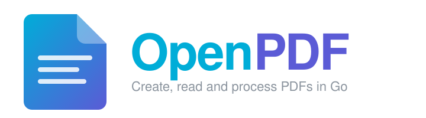

  

  
  
  
  
  
  
  

# OpenPDF - PDF for Go

OpenPDF is an MIT-licensed PDF library for Go (golang) for creating, reading and processing PDF files.

## Contents

- [Installation](#installation)
- [Quick start](#quick-start)
- [Features](#features)
- [Packages](#packages)
- [Examples](#examples)
- [Contributing](#contributing)
- [License](#license)

## Installation

Requires Go 1.27 or later.

~~~
go get github.com/OpenMellon/openpdf
~~~

## Quick start

### Create a PDF

~~~go
package main

import (
	"log"

	"github.com/OpenMellon/openpdf/creator"
)

func main() {
	c := creator.New()
	c.NewPage()

	p := c.NewStyledParagraph()
	p.SetText("Hello, OpenPDF")
	p.SetFontSize(20)
	if err := c.Draw(p); err != nil {
		log.Fatal(err)
	}

	if err := c.WriteToFile("hello.pdf"); err != nil {
		log.Fatal(err)
	}
}
~~~

### Extract text

~~~go
reader, f, err := model.NewPdfReaderFromFile("in.pdf", nil)
if err != nil {
	log.Fatal(err)
}
defer f.Close()

page, err := reader.GetPage(1)
if err != nil {
	log.Fatal(err)
}
ex, err := extractor.New(page)
if err != nil {
	log.Fatal(err)
}
text, err := ex.ExtractText()
~~~

### Merge and split

~~~go
// Merge in1.pdf and in2.pdf into out.pdf (last argument: merge form fields too).
err := pdfutil.MergePdf([]string{"in1.pdf", "in2.pdf"}, "out.pdf", false)

// Keep pages 2-4 only.
err = pdfutil.ExtractPageRange("in.pdf", "pages.pdf", 2, 4, false)
~~~

Imports used above: `github.com/OpenMellon/openpdf/{creator,extractor,model,pdfutil}`.

## Features

Each feature links to a runnable example, or to the package that provides it where there is no example yet.

| Feature | Example / package |
|---|---|
| Create reports, tables, invoices and styled paragraphs | [example](creator/example_test.go), [creator](creator) |
| Add images and watermarks to pages | [example](creator/example_test.go), [creator](creator) |
| Merge PDFs | [example](pdfutil/example_test.go), [pdfutil](pdfutil) |
| Split, rotate and reorder pages | [example](pdfutil/example_test.go), [pdfutil](pdfutil), [model](model) |
| Extract text (with size, position and formatting) and images | [example](extractor/example_test.go), [extractor](extractor) |
| Compress and optimise PDF files | [example](model/optimize/example_test.go), [model/optimize](model/optimize) |
| Password protection and unlocking | [example](model/example_test.go), [model](model) |
| Create, fill and flatten forms | [example](annotator/example_test.go), [annotator](annotator) |
| FDF and JSON form data | [fdf](fdf), [fjson](fjson) |
| Digital signing and signature validation | [example](model/sighandler/example_test.go), [model/sighandler](model/sighandler), [timestamp](https://github.com/unidoc/timestamp) |
| Redaction | [example](redactor/example_test.go), [redactor](redactor) |
| Sanitisation | [sanitize](sanitize) |
| PDF/A and PDF/UA | [model/pdfa](model/pdfa), [model/pdfua](model/pdfua) |
| Render pages to images | [render](render) |
| OCR integration | [ocr](ocr) |
| Charts, Arabic shaping and complex text layout | [unichart](https://github.com/unidoc/unichart), [garabic](https://github.com/unidoc/garabic), [textshaping](textshaping), [typesetting](https://github.com/unidoc/typesetting) |

## Packages

| Package | Use it to |
|---|---|
| [`creator`](creator) | Build documents: pages, text, tables, images, headers, footers, TOC |
| [`model`](model) | Read and write PDFs at page level; encryption, forms, signatures |
| [`extractor`](extractor) | Pull text, images and fonts out of pages |
| [`pdfutil`](pdfutil) | One-call merge, page-range extraction, grayscale |
| [`annotator`](annotator) | Form fields, signature fields and annotation appearances |
| [`core`](core) | Low-level PDF objects and parsing |
| [`contentstream`](contentstream) | Parse and generate page content streams |

Full API reference: [pkg.go.dev/github.com/OpenMellon/openpdf](https://pkg.go.dev/github.com/OpenMellon/openpdf).

## Examples

Examples are Go [testable examples](https://go.dev/blog/examples): `Example` functions in `example_test.go` files
that appear beside the API on pkg.go.dev and are compiled and run by `go test`, so they cannot go stale.

~~~
go test ./... -run Example -v
~~~

## Contributing

Contributions are welcome. See [CONTRIBUTING.md](CONTRIBUTING.md) for development setup, how to open a pull
request and how to update the regression goldens in `internal/regress`, and [SUPPORT.md](SUPPORT.md) for where to
ask questions. Report security vulnerabilities privately as described in [SECURITY.md](SECURITY.md). Everyone taking
part is expected to follow the [Code of Conduct](CODE_OF_CONDUCT.md).

## License

MIT - see [LICENSE](LICENSE). OpenPDF is a derivative of UniPDF, Copyright 2020 FoxyUtils ehf., which was released
under the MIT licence; the original copyright notices are retained in the source files and must stay with any copy.
Packages derived from other projects are separate modules: `unitype` under `github.com/OpenMellon/` (upstream is under the UniDoc EULA, not an open licence), and `freetype`, `garabic`, `go-xmp`, `pkcs7`, `timestamp`, `typesetting` and `unichart` upstream under `github.com/unidoc/`. Each keeps its own licence; see
[ACKNOWLEDGEMENTS.md](ACKNOWLEDGEMENTS.md).
